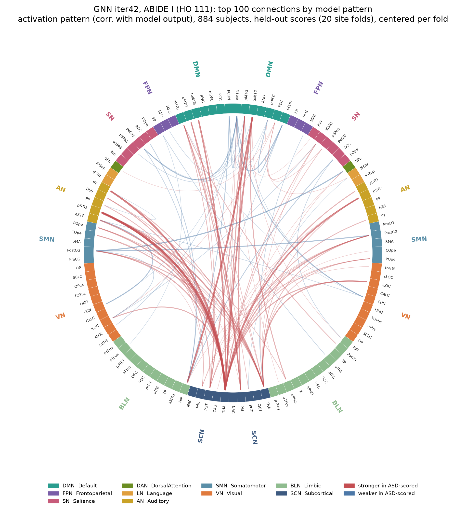
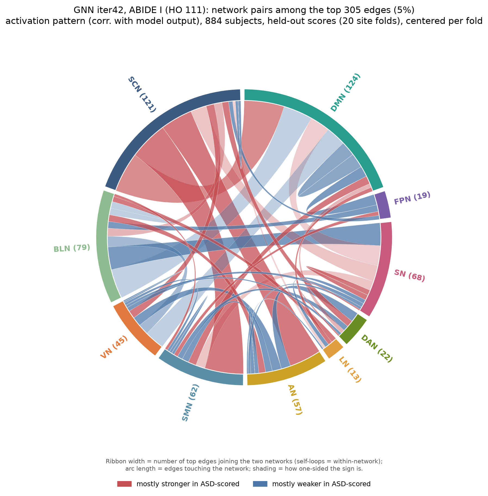

# GNN iter42 report: ASD classification on unseen ABIDE I sites

Release [`gnn-iter42-v1`](https://github.com/aaron-zhlg/neuroasd/releases/tag/gnn-iter42-v1), PR
[#13](https://github.com/aaron-zhlg/neuroasd/pull/13), branch
`experiment/trial-iter42_eval-time-augmentation-averaging`. This is the best GNN from the
September autoresearch loop.

## Summary

- **AUC 0.717 and accuracy 64.2% under leave-one-site-out** on ABIDE I (20 sites, 884 subjects).
  A rerun with every prediction kept gives 0.714 / 63.8%; the gap comes from non-deterministic
  GPU arithmetic.
- **ASD recall (sensitivity) is 48.6%, control recall 77.2%.** The model calls too few subjects
  ASD: about half of the ASD subjects at an unseen site are labelled control.
- **Below the cross-site literature on the same data.** Abraham 2017 reaches 66.8% accuracy with
  61.0% sensitivity using a linear model on ABIDE I. The linear iter10 model is stronger on every
  metric, though on different data.
- **The connections it tracks are subcortical.** The strongest pattern is subcortical
  connectivity with the default, somatomotor and auditory networks, higher in subjects the model
  scores as ASD.

## Data and model

- ABIDE I, PCP *ABIDE Preprocessed*, C-PAC `filt_global`, Harvard-Oxford `rois_ho`: 111 ROIs,
  Pearson FC. 884 subjects (408 ASD / 476 control), 20 sites.
- Two-layer GCN: node features are each ROI's Fisher-z FC row, the graph is |FC|, mean pooling,
  hidden 64, dropout 0.5.
- Training: Adam with lr 1e-3, batch 32, 100 epochs, cosine LR, seed 42. Stacked by the loop:
  - per-site edge quantile maps from the training folds;
  - per-epoch EMA (0.99), read once at the final epoch;
  - site-adversarial head (λ up to 0.1);
  - CORAL (0.1);
  - worst-site group DRO;
  - site-stratified mixup (α 0.2);
  - DropEdge (p 0.1);
  - at the final read, 8 DropEdge draws averaged (iter42's own change).
- Labels: control if P(control) > 0.5. No threshold is tuned.

## Results

Leave-one-site-out, one fit per held-out site, final-epoch EMA weights. Mean ± SD over 20 sites.

| Run | AUC | Accuracy | Balanced acc. | ASD recall | Control recall |
|---|---|---|---|---|---|
| Release run (PR #13, 2026-09-20) | **0.717 ± 0.115** | 64.2% ± 9.9 | – | – | – |
| Rerun with predictions kept | 0.714 ± 0.112 | 63.8% ± 9.9 | 62.9% ± 9.7 | 48.6% ± 17.9 | 77.2% ± 13.6 |

The release run did not save per-subject predictions, so recall comes from the rerun. The rerun
uses the same code, data, folds and seed. Its AUC differs by 0.003 because MPS GPU kernels are
not deterministic.

## Recall

ASD is the positive class. Rerun predictions:
[`recall.json`](../experiments/iter42_eval-time-augmentation-averaging_v1/recall.json).

**Fold mean ± SD**

| ASD recall | Control recall | ASD precision | ASD F1 |
|---|---|---|---|
| **48.6% ± 17.9** | 77.2% ± 13.6 | 67.3% ± 17.3 | 54.1% ± 14.8 |

**Pooled over all 884 held-out predictions**

| TP | FN | FP | TN | ASD recall | Control recall | ASD precision | NPV |
|---|---|---|---|---|---|---|---|
| 207 | 201 | 101 | 375 | **50.7%** | 78.8% | 67.2% | 65.1% |

- **Low recall comes from the cut, not only the ranking.** The model follows the training prior
  (54% control) and the site shift. Per site, ASD recall runs from 14% (LEUVEN_1) to 88%
  (UCLA_2).
- **ROC operating points.** The cut here is read off the test ROC, so it describes the curve and
  is not a deployable threshold. On one ROC over all held-out sites, ASD recall is:

| Specificity | 50% | 62% | 69.3% | 71.9% | 80% |
|---|---|---|---|---|---|
| ASD recall | 77.7% | 69.6% | 66.4% | 63.2% | 48.3% |

## Comparison

**Cross-site, ABIDE I** (test site never seen in training). Fold means as each paper reports them.

| Study | Data | Accuracy | ASD recall (sens.) | Control recall (spec.) | AUC |
|---|---|---|---|---|---|
| Abraham 2017 | ABIDE I, C-PAC, 871, LOSO | **66.8%** | **61.0%**¹ | 72.3% | – |
| Heinsfeld 2018 | ABIDE I, C-PAC, 1,035, LOSO | 65% | **69%** | 62% | – |
| Baseline GCN (`loso_cv_gcn_v1`) | ABIDE I, C-PAC, 884, LOSO | 59.3% | – | – | 0.623 |
| **GNN iter42** | ABIDE I, C-PAC, 884, LOSO | 63.8–64.2% | 48.6% | **77.2%** | **0.714–0.717** |

¹ Abraham's caption defines sensitivity as the share of predicted-ASD subjects who are ASD, which
is precision. Read with care.

**Against iter10** ([`iter10-model-v1`](https://github.com/aaron-zhlg/neuroasd/releases/tag/iter10-model-v1),
linear, DCAN ABIDE I + II, 1,443 subjects, 33 sites, LOSO): accuracy 69.4% per subject or 71.9%
per group, AUC 0.797, ASD recall 54.7% per subject or 74.5% per group. Different data and
preprocessing, so this is not a same-data comparison.

- iter42 is above the baseline GCN by +0.09 AUC, but below Abraham's linear model on the same
  ABIDE I data by about 3 pp accuracy.
- Its control recall is the highest in the table; its ASD recall is the lowest. The model is
  conservative: it rarely calls ASD.

## Which connections the model uses

Same measure as the iter10 figures: the correlation between each edge's Fisher-z FC and the
model's output, flipped to ASD direction. Red means stronger in subjects the model scores as
ASD; blue means weaker.

Unlike iter10, the scores here are **held-out**: each subject is scored by the model that did not
see its site. Score and FC are centered within each held-out site, so site offsets do not
enter. A model fit on all subjects reaches training AUC 0.97 and mostly tracks the labels.
Network pairs use the top 5% of edges (305 of 6,105), because HO has far fewer edges than
Gordon.





| Network pair | Top edges | Weaker / stronger in ASD | Enrichment |
|---|---|---|---|
| Default – Subcortical | 30 | 3 / 27 | 4.3× |
| Somatomotor – Subcortical | 29 | 0 / 29 | 5.8× |
| Auditory – Subcortical | 24 | 0 / 24 | 4.8× |
| Default – Limbic | 22 | 13 / 9 | 1.4× |
| Salience – Limbic | 17 | 17 / 0 | 1.2× |
| Salience – Subcortical | 12 | 5 / 7 | 2.0× |

- **Subcortical–cortical connections are stronger in ASD-scored subjects.** This holds for the
  default, somatomotor and auditory networks, and it matches reports of thalamo-cortical
  over-connectivity in ASD.
- **Salience–limbic connections are weaker.**
- **Different from iter10.** iter10 leans on within-network under-connectivity. The two models
  use different atlases, data and preprocessing, so the difference may not be about the model.

Edge list: [`edges.csv`](../experiments/iter42_eval-time-augmentation-averaging_v1/chord/edges.csv).
Network counts: [`networks.json`](../experiments/iter42_eval-time-augmentation-averaging_v1/chord/networks.json).

## Limitations

- **Selected on the reported splits.** The loop compared about 40 variants on these same LOSO
  folds, so the scores are optimistic.
- **Gains after iter6 are within noise.** The later mechanisms add +0.027 AUC together, well
  inside one fold SD of 0.115. No ablation was run.
- **Untuned defaults.** Hyperparameters and atlas were never compared.
- **No saved weights.** The harness does not save model weights.
- **The connection pattern is correlational.** It describes what the output tracks, not how the
  GCN computes it.

## Reproduce

```bash
# official trial (release numbers)
uv run python -m autoresearch.trial --name iter42_eval-time-augmentation-averaging --stage loso-full

# rerun keeping every prediction (recall)
uv run python -m scripts.gnn_dcan_eval --data-dir data/abide --grouping site \
    --out experiments/iter42_eval-time-augmentation-averaging_v1/recall.json

# connection chords from the held-out scores
uv run python -m scripts.gnn_chord --atlas ho --data-dir data/abide \
    --scores experiments/iter42_eval-time-augmentation-averaging_v1/recall.json \
    --out-dir experiments/iter42_eval-time-augmentation-averaging_v1/chord --label "GNN iter42, ABIDE I (HO 111)"
```
