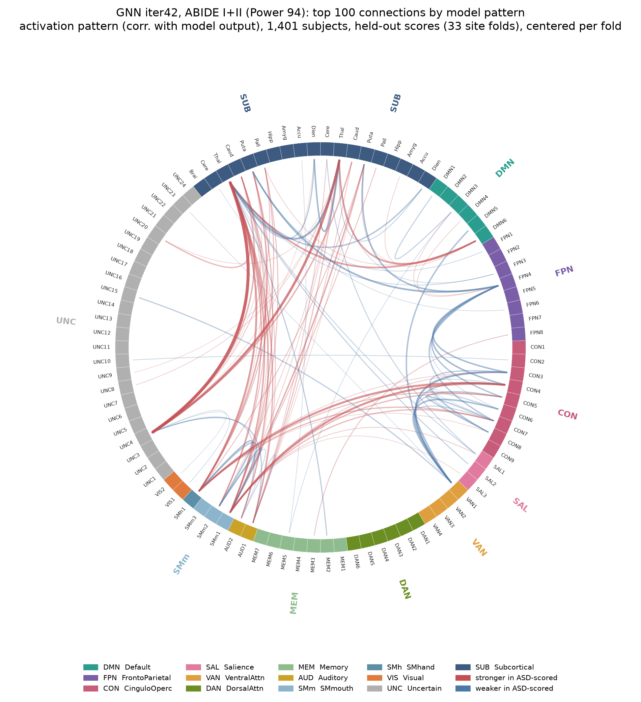
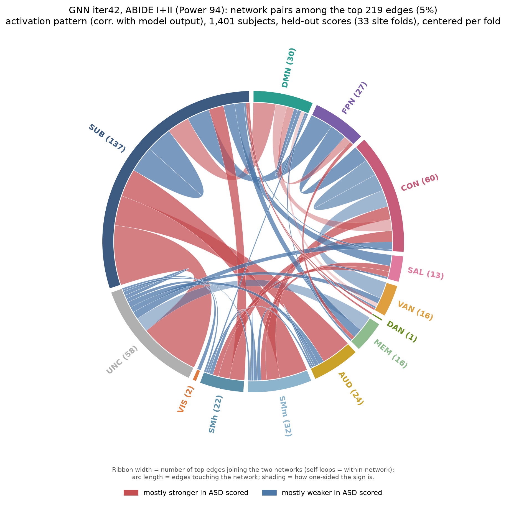

# GNN iter42 on ABIDE I + II (Power 94): ASD classification on unseen sites

Release `gnn-iter42-abide12-power-v1`, branch `experiment/gnn-iter42-abide12-power`. The GNN from
release [`gnn-iter42-v1`](https://github.com/aaron-zhlg/neuroasd/releases/tag/gnn-iter42-v1),
code unchanged, trained and tested on ABIDE I + II instead of ABIDE I alone.

## Summary

- **Adding ABIDE II did not help.** AUC 0.695 leave-one-site-out (33 sites, 1,401 subjects),
  against 0.717 for the same model on ABIDE I alone. Accuracy 63.3% vs 64.2%.
- **ASD recall is a little higher: 54.4% vs 48.6%.** Control recall drops from 77.2% to 71.6%.
- **Leave-one-institution-out (23 institutions, 1,443 subjects): AUC 0.680, accuracy 62.5%.**
  The linear iter10 model scores AUC 0.779 on the same subjects and splits.
- **Same connection pattern as on ABIDE I.** Subcortical connections with the auditory and
  mouth-somatomotor networks are stronger in subjects the model scores as ASD.

## Data and model

- DCAN (ABCD-HCP pipeline) ABIDE I + II, Power 2011 atlas with FreeSurfer subcortical regions:
  94 parcels, Pearson FC. 1,443 subjects (631 ASD / 812 control), 35 sites.
  Data directory: `data/abide_dcan_power`.
- Model and training: exactly as in `gnn-iter42-v1` (two-layer GCN, Fisher-z node features,
  per-site edge quantile maps, EMA 0.99, site-adversarial 0.1, CORAL 0.1, site DRO, site mixup
  0.2, DropEdge 0.1, 8-draw averaging at the final read; 100 epochs, batch 32, lr 1e-3, seed 42).
  `scripts/gnn_dcan_eval.py` calls iter42's `run_fold` without change and only records the
  per-subject probabilities.
- Labels: control if P(control) > 0.5. No threshold is tuned.
- Held-out groups are the same as iter10's: 33 sites that have both classes, and 23 institutions.

## Results

Mean ± SD over held-out groups. Final-epoch EMA weights, nothing chosen on the held-out group.

| Run | AUC | Accuracy | Balanced acc. | ASD recall | Control recall |
|---|---|---|---|---|---|
| ABIDE I, HO 111, 20 sites (`gnn-iter42-v1`) | **0.717 ± 0.115** | **64.2% ± 9.9** | 62.9% ± 9.7 | 48.6% ± 17.9 | **77.2% ± 13.6** |
| ABIDE I + II, Power 94, 33 sites | 0.695 ± 0.095 | 63.3% ± 8.0 | **63.0% ± 7.7** | **54.4% ± 20.5** | 71.6% ± 13.2 |
| ABIDE I + II, Power 94, 23 institutions | 0.680 ± 0.098 | 62.5% ± 7.4 | 62.7% ± 7.0 | 52.8% ± 21.3 | 72.7% ± 14.1 |

The ABIDE I row's recall comes from its rerun (AUC 0.714); see that release's report.

## Recall

ASD is the positive class. Pooled over all held-out predictions:

| Split | n | TP | FN | FP | TN | ASD recall | Control recall | ASD precision | NPV |
|---|---|---|---|---|---|---|---|---|---|
| 33 sites | 1,401 | 326 | 263 | 234 | 578 | **55.3%** | 71.2% | 58.2% | 68.7% |
| 23 institutions | 1,443 | 347 | 284 | 249 | 563 | **55.0%** | 69.3% | 58.2% | 66.5% |

- Recall varies a lot by site: from 0% (ABIDEII-BNI_1) to 100% (CALTECH).
- **Against iter10** ([`iter10-model-v1`](https://github.com/aaron-zhlg/neuroasd/releases/tag/iter10-model-v1),
  same subjects and splits): leave-one-site-out ASD recall 54.7% per subject or 74.5% per group,
  AUC 0.797. The GNN matches iter10's per-subject recall but has lower AUC by about 0.1.
- **Against the literature** (ABIDE I only, cross-site): Abraham 2017 61.0% sensitivity / 72.3%
  specificity; Heinsfeld 2018 69% / 62%. This GNN is below both on ASD recall.

## Which connections the model uses

Same method as `gnn-iter42-v1`: correlation of each edge's Fisher-z FC with the held-out
logit(P(control)), flipped to ASD direction, with both centered within each held-out site.
Network pairs use the top 5% of edges (219 of 4,371).





| Network pair | Top edges | Weaker / stronger in ASD | Enrichment |
|---|---|---|---|
| Uncertain – Subcortical | 32 | 1 / 31 | 1.4× |
| Auditory – Subcortical | 16 | 0 / 16 | 8.4× |
| SMmouth – Subcortical | 15 | 0 / 15 | 5.3× |
| Subcortical – Subcortical | 14 | 14 / 0 | 1.6× |
| Default – Subcortical | 12 | 2 / 10 | 2.1× |
| FrontoParietal – Subcortical | 12 | 12 / 0 | 1.6× |

- **Subcortical–sensory connections are stronger in ASD-scored subjects**, as on ABIDE I with a
  different atlas and pipeline. The signal holds across both datasets.
- **Connections within the subcortex, and between subcortex and fronto-parietal regions, are
  weaker.**
- "Uncertain" is Power's label for parcels without a network assignment.

Edge list: [`edges.csv`](../experiments/gnn_iter42_abide12_power_v1/chord/edges.csv).
Network counts: [`networks.json`](../experiments/gnn_iter42_abide12_power_v1/chord/networks.json).

## Limitations

- **Not a same-data comparison with `gnn-iter42-v1`.** Data, atlas and preprocessing all change
  together, so the drop in AUC cannot be pinned on ABIDE II alone.
- **Hyperparameters tuned on ABIDE I.** The iter42 stack was chosen on ABIDE I LOSO folds and was
  not retuned here.
- **One seed, no saved weights.** MPS GPU arithmetic is not deterministic.
- **The connection pattern is correlational.**

## Reproduce

```bash
uv run python -m scripts.gnn_dcan_eval --data-dir data/abide_dcan_power --grouping site \
    --out experiments/gnn_iter42_abide12_power_v1/loso_site.json
uv run python -m scripts.gnn_dcan_eval --data-dir data/abide_dcan_power --grouping institution \
    --out experiments/gnn_iter42_abide12_power_v1/loso_institution.json
uv run python -m scripts.gnn_chord --atlas power --data-dir data/abide_dcan_power \
    --scores experiments/gnn_iter42_abide12_power_v1/loso_site.json \
    --out-dir experiments/gnn_iter42_abide12_power_v1/chord --label "GNN iter42, ABIDE I+II (Power 94)"
```

Run time on an M-series Mac: about 85 min for the 33 site folds, 60 min for the 23 institutions.
