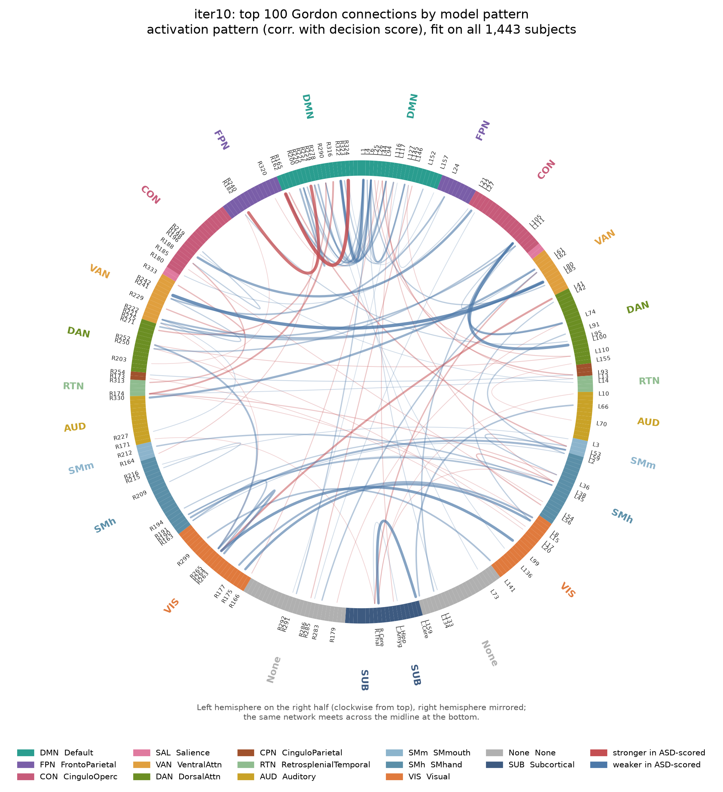
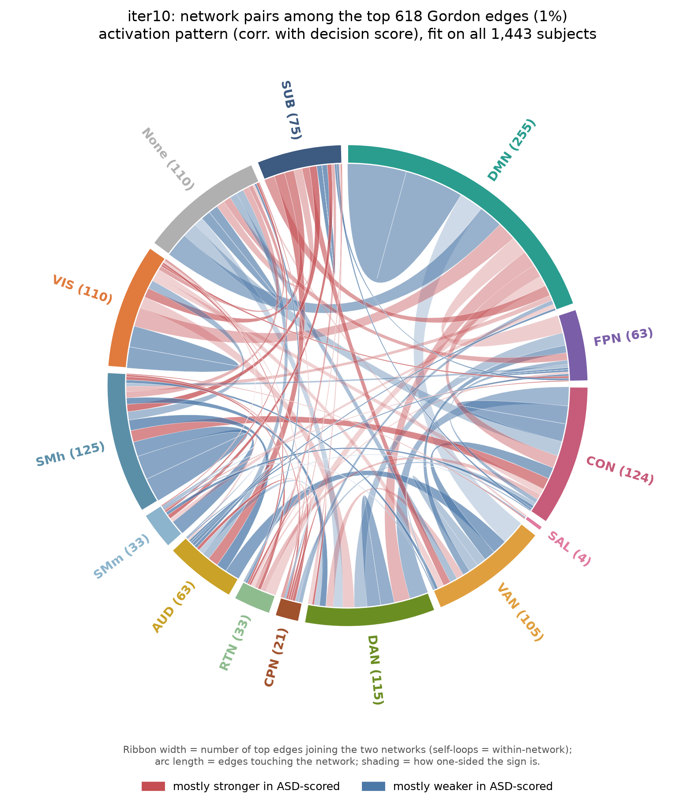

# iter10 report: ASD classification from resting-state fMRI across unseen institutions

Release [`iter10-model-v1`](https://github.com/aaron-zhlg/neuroasd/releases/tag/iter10-model-v1),
branch `experiment/trial-iter10_estimator-swap-replace-the-singl`.
Model details and the per-step lineage: [`paper_notes_iter10.md`](paper_notes_iter10.md).

## Summary

On 1,443 DCAN-preprocessed ABIDE I + II subjects, a linear classifier on two-atlas tangent-space
connectivity reaches **70.1% accuracy and AUC 0.78 under leave-one-institution-out** (23
institutions, with label-free per-site calibration). This protocol is stricter than both the
random or site-stratified splits used by most studies and the leave-one-site-out used by a few:
no scanner of the test institution is seen in training.

- **Same score, stricter test.** GNN, Transformer, and foundation-model studies report 70–73%
  accuracy (AUC up to 0.80) on random or site-stratified splits, where every test site is also in
  training. We reach a comparable 70.1% / AUC 0.78 on unseen institutions. Scoring each subject
  independently, the model reaches 69.4% / AUC 0.80 under leave-one-site-out.
- **On the same random splits**, scored per subject as those studies do, the model reaches
  **71–72% accuracy and AUC 0.80–0.81**.
- **Against cross-site studies**, under a stricter hold-out, accuracy is above Abraham 2017
  (66.8% leave-one-site-out) and AUC is within the range IMPAC reports on unseen cohorts
  (0.72–0.81).
- **ASD recall (sensitivity) is 70.8% on unseen institutions** (74.5% leave-one-site-out) with
  per-group scoring, with control recall at 70.9% (71.2% LOSO). That is in the 69–74% range
  reported by the deep-model papers, which use easier splits. Scored per subject with a cut at
  0, the model is conservative: ASD recall drops to 54–55% and control recall rises to 80–86%.
  See [Recall](#recall).

## Model

- Tangent-space FC (log-Euclidean reference from training subjects only, shrinkage 0.1) on the
  Gordon (352 parcels) and HCP2016 (379 parcels) atlases, concatenated.
- Age and sex columns; all columns standardized with training statistics.
- L2 logistic regression, fixed `C = 1e-2` (no inner search, nothing chosen on a test fold).
- Two ways to turn scores into labels:
  - **per-subject**: each subject on its own, control if the decision value is > 0. This is how
    most papers score a classifier.
  - **per-group** (iter10 as released): each test site / institution is z-scored with its own
    *unlabeled* score mean and SD, then cut at a threshold learned on training folds. This needs
    a batch of subjects from the same site.

## Results

One fit per fold. Fold mean ± SD; k-fold rows are 10 folds × 3 reshuffles.

| Split | Scoring | Accuracy | Balanced acc. | AUC | ASD recall | Control recall |
|---|---|---|---|---|---|---|
| Leave-one-institution-out (23) | per-group | **70.1% ± 8.5** | **70.8% ± 8.1** | **0.779 ± 0.087** | 70.8% | 70.9% |
| Leave-one-institution-out (23) | per-subject | 67.4% ± 10.7 | 67.7% ± 9.4 | 0.779 ± 0.087 | 55.0% | 80.3% |
| Leave-one-site-out (33) | per-group | 71.9% ± 9.6 | 72.8% ± 9.4 | 0.797 ± 0.098 | 74.5% | 71.2% |
| Leave-one-site-out (33) | per-subject | 69.4% ± 9.6 | 68.3% ± 10.1 | 0.797 ± 0.098 | 54.7% | 81.9% |
| Site-stratified 10-fold | per-subject | 72.2% ± 3.4 | 70.3% ± 3.5 | 0.809 ± 0.035 | 54.6% | 85.9% |
| Random 10-fold | per-subject | 71.3% ± 3.6 | 69.4% ± 3.7 | 0.801 ± 0.032 | 53.6% | 85.1% |

Per-group scoring under random / stratified k-fold (a site has only 1–3 test subjects per fold,
so the per-site z-score is noise) is in
[`split_schemes.json`](../experiments/iter10_estimator-swap-replace-the-singl_v1/split_schemes.json);
it lowers AUC to 0.74–0.78 and should not be used for those splits.

## Recall

ASD is the positive class. *ASD recall* (sensitivity) = ASD subjects called ASD / all ASD
subjects; *control recall* (specificity) is the same for controls; *ASD precision* = ASD
subjects / all subjects called ASD. Rerun of every fold with every prediction kept
([`scripts/eval_recall.py`](../scripts/eval_recall.py),
[`recall.json`](../experiments/iter10_estimator-swap-replace-the-singl_v1/recall.json)). Its fold
means reproduce the table above exactly. 1,443 subjects: 631 ASD, 812 control.

**Fold mean ± SD** (how the papers below report it)

| Split | Scoring | ASD recall | Control recall | ASD precision | ASD F1 |
|---|---|---|---|---|---|
| Leave-one-institution-out (23) | per-group | **70.8% ± 11.8** | 70.9% ± 9.3 | 65.8% ± 13.5 | 67.2% ± 11.0 |
| Leave-one-institution-out (23) | per-subject | 55.0% ± 21.1 | 80.3% ± 15.9 | 70.7% ± 17.9 | 58.3% ± 15.3 |
| Leave-one-site-out (33) | per-group | **74.5% ± 11.6** | 71.2% ± 11.7 | 66.6% ± 14.6 | 69.3% ± 11.2 |
| Leave-one-site-out (33) | per-subject | 54.7% ± 21.7 | 81.9% ± 14.3 | 70.5% ± 18.6 | 58.7% ± 16.9 |
| Site-stratified 10-fold ×3 | per-subject | 54.6% ± 5.9 | 85.9% ± 4.0 | 75.3% ± 5.6 | 63.1% ± 5.1 |
| Random 10-fold ×3 | per-subject | 53.6% ± 5.5 | 85.1% ± 4.1 | 73.9% ± 5.9 | 62.0% ± 5.0 |

**Pooled over all test predictions** (k-fold rows sum the 3 reshuffles, so each subject is
counted 3 times)

| Split | Scoring | TP | FN | FP | TN | ASD recall | Control recall | ASD precision | NPV |
|---|---|---|---|---|---|---|---|---|---|
| Leave-one-institution-out | per-group | 460 | 171 | 256 | 556 | **72.9%** | 68.5% | 64.3% | 76.5% |
| Leave-one-institution-out | per-subject | 342 | 289 | 182 | 630 | 54.2% | 77.6% | 65.3% | 68.6% |
| Leave-one-site-out | per-group | 440 | 149 | 255 | 557 | **74.7%** | 68.6% | 63.3% | 78.9% |
| Leave-one-site-out | per-subject | 330 | 259 | 160 | 652 | 56.0% | 80.3% | 67.4% | 71.6% |
| Site-stratified 10-fold ×3 | per-subject | 1,034 | 859 | 343 | 2,093 | 54.6% | 85.9% | 75.1% | 70.9% |
| Random 10-fold ×3 | per-subject | 1,014 | 879 | 362 | 2,074 | 53.6% | 85.1% | 73.7% | 70.2% |

LOSO leaves out the two ASD-only sites (`ABIDEII-KUL_3`, `ABIDEII-NYU_2`) as test folds, so it
scores 589 ASD subjects rather than 631.

**What the numbers say**

- **Low per-subject recall comes from the threshold, not the ranking.** At a cut of 0 the
  logistic model follows the training prior (56% control) and the site shift, so it calls too
  few subjects ASD. AUC is the same for both scorings. Per-group calibration moves the cut
  without labels, and ASD recall goes from 55% to 71–75%.
- **Per-group scoring trades precision for recall.** Pooled precision falls from 65–67% to
  63–64%. That is the expected direction once more subjects are called ASD.
- **Fold-to-fold spread is large across sites.** ASD recall SD is 12 pp per-group and 21 pp
  per-subject. Per institution, per-group recall runs from 43% (ABIDEII-EMC_1, 14 ASD) to 90%
  (YALE). Per-subject recall runs from 17% (ABIDEII-BNI_1) to 100% (CALTECH). Most institutions
  have only 10–40 ASD subjects, so each per-institution value is noisy. See `folds` in
  `recall.json`.

**Operating points on the ROC curve.** These show what the per-subject scores could reach at
the specificities the papers report. The cut is read off the test ROC, so these are
descriptions of the curve, not a deployable threshold. Mean over the 3 reshuffles; for LOSO /
LOIO, one ROC over all held-out sites.

| Split (per-subject scores) | Recall @ spec. 50% | @ 62% | @ 69.3% | @ 71.9% | @ 80% |
|---|---|---|---|---|---|
| Site-stratified 10-fold | 90.8% | 82.8% | 77.1% | 73.9% | 63.3% |
| Random 10-fold | 90.0% | 81.7% | 75.7% | 72.4% | 61.7% |
| Leave-one-site-out | 86.4% | 77.6% | 71.3% | 66.9% | 56.5% |
| Leave-one-institution-out | 84.5% | 73.2% | 67.0% | 64.0% | 49.8% |

The specificities are taken from Heinsfeld LOSO (62%), BrainNetTF (69.3%), and BrainMass
(71.9%). At those operating points, iter10 on a site-stratified split reaches 77.1% recall where
BrainNetTF reports 72.5%, and 73.9% where BrainMass reports 74.3%.

## Comparison with published results

Split by protocol: random-split and cross-site numbers are not comparable.

**Cross-site (test site never seen in training)**

| Study | Data | N | Validation | Accuracy | AUC |
|---|---|---|---|---|---|
| Abraham 2017 | ABIDE I | 871 | LOSO | 66.8% | – |
| Heinsfeld 2018 | ABIDE I | 1,035 | LOSO | 65% | – |
| El-Gazzar 2023 (harmonization) | ABIDE I+II (9 sites) | – | LOSO | 66.1–67.2% | – |
| Traut 2022 (IMPAC) | ABIDE I+II + private | 2,117 | One unseen site / EU-AIMS | – | 0.81 / 0.72 |
| **iter10, per-subject** | ABIDE I+II (DCAN) | 1,443 | LOSO (33 sites) | **69.4%** | **0.797** |
| **iter10, per-group** | ABIDE I+II (DCAN) | 1,443 | Leave-one-institution-out (23) | **70.1%** | **0.779** |

**Random or site-stratified splits (sites shared between train and test)**

| Study | Validation | Accuracy | AUC |
|---|---|---|---|
| Heinsfeld 2018 | 10-fold | 70% | – |
| Parisot 2018 (GCN) | 10-fold, transductive | 70.4% | 0.75 |
| Kan 2022 (BrainNetTF) | Site-stratified split | 71.0% | 0.80 |
| BrainMass 2024 | Site-stratified split | 72.8% | – |
| **iter10, per-subject** | Random 10-fold | **71.3%** | **0.801** |
| **iter10, per-subject** | Site-stratified 10-fold | **72.2%** | **0.809** |

A linear model matches the deep-model headline numbers on random splits, and keeps ~67–70% when
whole institutions are held out.

**Recall (sensitivity) and specificity reported in the literature**

ASD is positive. Fold means, as each paper reports them. "–" means the paper does not report
the value. Parisot 2018, El-Gazzar 2023 and Khosla 2019 report no sensitivity or specificity.

| Study | Validation | Accuracy | ASD recall (sens.) | Control recall (spec.) | AUC |
|---|---|---|---|---|---|
| *Cross-site* | | | | | |
| Abraham 2017 | LOSO, ABIDE I (871) | 66.8% | 61.0%¹ | 72.3% | – |
| Heinsfeld 2018 | LOSO, ABIDE I (1,035) | 65% | 69% | 62% | – |
| **iter10, per-group** | Leave-one-institution-out (23) | **70.1%** | **70.8%** | **70.9%** | **0.779** |
| **iter10, per-group** | LOSO (33) | **71.9%** | **74.5%** | **71.2%** | **0.797** |
| iter10, per-subject | Leave-one-institution-out (23) | 67.4% | 55.0% | 80.3% | 0.779 |
| iter10, per-subject | LOSO (33) | 69.4% | 54.7% | 81.9% | 0.797 |
| *Random or site-stratified* | | | | | |
| Nielsen 2013 | Leave-one-subject-out, ABIDE I (964) | 60.0% | 62% | 58% | – |
| Heinsfeld 2018 | Random 10-fold | 70% | 74% | 63% | – |
| Eslami 2019 (ASD-DiagNet) | Random 10-fold, ABIDE I (1,035) | 70.3% | 68.3% | 72.2% | – |
| Kan 2022 (BrainNetTF) | Site-stratified 70/10/20 ×5 | 71.0% | 72.5% ± 5.2 | 69.3% ± 6.5 | 0.802 |
| Kan 2022, BrainNetCNN baseline | same | 67.8% | 63.8% | 71.0% | 0.749 |
| Kan 2022, BrainGNN baseline | same | 59.4% | 36.7% | 70.7% | 0.624 |
| BrainMass 2024 | Site-stratified 70/15/15 | 72.8% | 74.3% | 71.9% | – |
| **iter10, per-subject** | Site-stratified 10-fold ×3 | **72.2%** | 54.6% | 85.9% | **0.809** |
| **iter10, per-subject** | Random 10-fold ×3 | **71.3%** | 53.6% | 85.1% | **0.801** |

¹ Abraham's Table 2 caption defines sensitivity as "the ratio of ASD individuals among all
subjects classified as ASD", which is precision, not recall. Read this cell with care.

Traut 2022 (IMPAC) reports operating points instead of one cut: 88% sensitivity at 50%
specificity ("screening") and 25% at 97% ("confirmatory") on its private test set. iter10's
per-subject ROC gives 84.5–90.8% recall at 50% specificity, depending on the split.

- **Cross-site, iter10 has the highest reported recall.** Per-group scoring gives 70.8%
  (institution) and 74.5% (site), against Heinsfeld's 69% and Abraham's 61%. Specificity
  (70.9–71.2%) is above Heinsfeld's 62% and slightly below Abraham's 72.3%.
- **On random splits, the papers report balanced recall and specificity; iter10 per-subject
  does not.** Its accuracy is equal or higher, but the cut at 0 sits at 54% recall / 85%
  specificity. At BrainNetTF's and BrainMass's specificities, the site-stratified ROC gives
  77.1% and 73.9% recall (see [Recall](#recall)). That is level with or above the 72.5% and
  74.3% those papers report. The difference is where the threshold sits, not
  how well the model separates the classes.
- Sources: Abraham arXiv 1611.06066 Table 2; Heinsfeld PMC5635344 Tables 2–3; Nielsen
  PMC3782703; Eslami PMC6890833 Table 2; Kan arXiv 2210.06681 Table 1; BrainMass arXiv
  2403.01433v1 Table II; Traut medRxiv 2021.11.24.21266768v2 Fig. 2.

## Same-data baseline

The fairest comparison is Abraham's recipe (tangent space + linear classifier, per-subject cut at
0) on our own data and splits, tag `linear-baseline-dcan-v1`:

| Split | Gordon tangent + ridge | iter10, per-subject | iter10, per-group |
|---|---|---|---|
| Leave-one-site-out | 68.6% / AUC 0.775 | 69.4% / 0.797 | 71.9% / 0.797 |
| Leave-one-institution-out | 67.0% / AUC 0.770 | 67.4% / 0.779 | 70.1% / 0.779 |

- Abraham's recipe already reaches 68.6% LOSO here, above the 66.8% in his paper; most of the
  gap to the literature comes from the data (DCAN preprocessing, ABIDE I+II, more subjects).
- The model change (second atlas, covariates, logistic regression) adds +0.4–0.9 pp accuracy and
  +0.01–0.02 AUC. No paired test has been run; fold SD is 8–10 pp.
- Per-group calibration adds a further +2.4–2.7 pp accuracy (+3.1–4.6 pp balanced accuracy).

## Finding: label-free per-site calibration

Under leave-one-group-out, z-scoring each test site's scores with its own unlabeled mean and SD
leaves AUC unchanged (the transform is monotone within a site) but moves the operating point:

| Split | Scoring | Balanced acc. | ASD recall | Control recall |
|---|---|---|---|---|
| Leave-one-site-out | per-subject | 68.3% | 54.7% | 81.9% |
| Leave-one-site-out | per-group | **72.8%** | **74.5%** | 71.2% |
| Leave-one-institution-out | per-subject | 67.7% | 55.0% | 80.3% |
| Leave-one-institution-out | per-group | **70.8%** | **70.8%** | 70.9% |

A cut at 0 misses about 45% of ASD subjects at unseen sites, because each site shifts the score
distribution. Calibrating per site, without labels, recovers balanced recall. The cost: the model
must score a batch of subjects from one site together; a single new subject cannot be calibrated.

## Which connections the model uses

iter10 is linear, so each connection has one weight. Raw weights over ~134k correlated features
are hard to read (Haufe et al. 2014). The figures therefore show the *activation pattern*: the
correlation between each Gordon edge's tangent-space value and the model's decision score,
with the model fit once on all 1,443 subjects. Red means the connection is stronger in subjects
the model scores as ASD; blue means weaker. The Gordon block carries 46% of the squared
weight norm and the HCP2016 block 54%; age and sex carry almost none.





Network pairs among the top 1% (618) of Gordon edges by |pattern|. Enrichment is the count over
what random placement would give.

| Network pair | Top edges | Weaker in ASD / stronger | Enrichment |
|---|---|---|---|
| Default – Default | 56 | 47 / 9 | 6.8× |
| SMhand – SMhand | 23 | 21 / 2 | 3.3× |
| Visual – Visual | 20 | 18 / 2 | 2.7× |
| Default – VentralAttn | 23 | 12 / 11 | 2.4× |
| CinguloOperc – CinguloOperc | 17 | 15 / 2 | 2.2× |
| Default – FrontoParietal | 17 | 8 / 9 | 1.7× |
| CinguloOperc – DorsalAttn | 18 | 14 / 4 | 1.4× |

- **Within-network under-connectivity dominates.** The leading pairs are within the default,
  somatomotor, visual and cingulo-opercular networks, and they are mostly weaker in
  ASD-scored subjects. This is the pattern most ABIDE studies report as ASD
  hypoconnectivity.
- **Between-network edges are mixed.** Default–ventral attention, default–frontoparietal and
  default–dorsal attention have stronger and weaker edges in similar numbers.
- **Each edge is weak on its own.** The largest |r| is 0.14, so the model works by pooling many
  small effects; no single connection is diagnostic.

Edge list: [`chord_iter10_edges.csv`](../experiments/iter10_estimator-swap-replace-the-singl_v1/chord/chord_iter10_edges.csv).
Network counts: [`chord_iter10_networks.json`](../experiments/iter10_estimator-swap-replace-the-singl_v1/chord/chord_iter10_networks.json).

## Limitations

- **Model selection on the evaluation splits.** iter10 was chosen by an automated loop that
  compared about ten variants on these same leave-one-site-out and leave-one-institution-out
  splits. Its scores on those splits are optimistic; the baseline was not selected this way.
- **No untouched test set.** No institution or external cohort (e.g. EU-AIMS LEAP) was held back
  from model selection.
- **Different data from the papers.** DCAN ABIDE I+II vs mostly C-PAC ABIDE I; the tables compare
  protocols, not identical experiments.
- **No significance tests** versus the baseline or the literature.
- **Per-group scoring is transductive.** It uses unlabeled statistics of the test site.
- **The connection figures come from one full-data fit.** Their stability across folds or
  bootstrap resamples has not been tested, and the HCP2016 block (54% of the weight) is not
  drawn because its parcels have no network labels here.

To support a stronger claim: freeze iter10, evaluate once on held-back institutions or an
external cohort, and run paired tests against the same-data baseline.

## External cohorts

The scores above are inside ABIDE. Cohorts that can score this model on people it has not
seen are listed in [`doc/external_asd_test_datasets.md`](external_asd_test_datasets.md).

- **EU-AIMS LEAP** is the external ASD test. IMPAC reported AUC 0.72 there. Access is by
  application; the current share is processed data.
- **Healthy Brain Network** is the more open pediatric set (ASD and ADHD). Imaging releases
  are posted for download; phenotypes need a data-use agreement.
- **ABCD** is the HCP-style longitudinal cohort that also has BMI. Current moderate or severe
  ASD was an enrollment exclusion, and the released ASD item is parent-report KSADS, so it
  answers an ASD-and-obesity question rather than standing in for ABIDE.
- The 14 Connectomes Related to Human Disease projects and HCP-Development document the
  HCP-style protocol. They are not ASD case-control sets.

The released model still expects Gordon and HCP2016 connectivity in the `abide_dcan` layout,
plus age and sex. Per-subject scoring is the one to use when each person is scored alone.

## Reproduce

Data: DCAN ABIDE I+II FC matrices (`data/abide_dcan`, `data/abide_dcan_hcp`; build with
`data/abide_dcan/scripts/build_dcan_dataset.py`).

```bash
# cross-validation, any split and scoring
uv run python -m scripts.train_model --data-root data --split institution --cv
uv run python -m scripts.train_model --data-root data --split site --cv --scoring per-subject
uv run python -m scripts.train_model --data-root data --split random --cv --folds 10 --repeats 3
uv run python -m scripts.train_model --data-root data --split stratified --cv --folds 10 --repeats 3

# train once on a split, save the model, then score it
uv run python -m scripts.train_model --data-root data --split institution --holdout NYU
uv run python -m scripts.test_model --data-root data --model outputs/models/institution_NYU/model.npz

# recall, precision and confusion matrices for every split (about 75 min on 3 workers)
uv run python -m scripts.eval_recall --data-root data

# chord diagrams of the model's connection pattern
uv run python -m scripts.plot_chord_iter10 --data-root data
```
